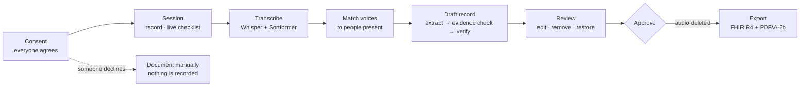
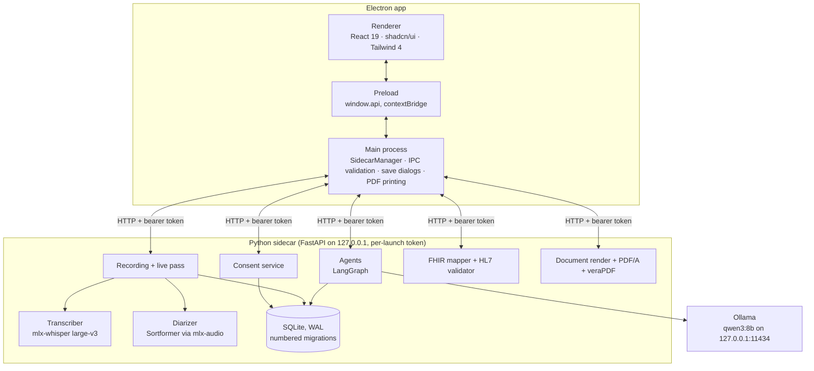

# Clinic Dictation

**A local, consent-gated scribe for German doctor–patient admission interviews.**

Clinic Dictation records a consultation only after everyone in the room has
agreed. It transcribes the recording on the doctor's own Mac and tells the
speakers apart. Local agents then draft the medical history, and every fact in
it is tied to the exact words it came from. The doctor checks the draft, corrects
it and approves it. Only then can it be exported, as a validated FHIR R4 document
for other systems and as a readable PDF/A document for people.

No audio, transcript or record ever leaves the machine. The app only structures
what was said. It never suggests a diagnosis, a code or a treatment.

Course project for **Frontier Systems 2026/27** (L3S Research Center, Leibniz
Universität Hannover), in the *AI for Good* track.

> [!IMPORTANT]
> This is a research prototype, not a certified medical device. Use only
> role-play or synthetic conversations with people who agreed to be recorded.
> Never use real patient data.

---

## Contents

- [Why](#why)
- [What it does](#what-it-does)
- [What it deliberately does not do](#what-it-deliberately-does-not-do)
- [How a consultation flows](#how-a-consultation-flows)
- [Architecture](#architecture)
- [What we tried and built around the models](#what-we-tried-and-built-around-the-models)
- [Privacy and security](#privacy-and-security)
- [Legal and regulatory notes](#legal-and-regulatory-notes)
- [Requirements](#requirements)
- [Setup](#setup)
- [Running the app](#running-the-app)
- [Testing and quality checks](#testing-and-quality-checks)
- [Evaluation](#evaluation)
- [Results so far](#results-so-far)
- [Sidecar API](#sidecar-api)
- [Where data lives](#where-data-lives)
- [Repository layout](#repository-layout)
- [Configuration](#configuration)
- [Troubleshooting](#troubleshooting)
- [Known limitations](#known-limitations)
- [Roadmap](#roadmap)
- [License and credits](#license-and-credits)

---

## Why

Writing up an admission interview takes doctors a large share of their working
day, and much of it is retyping what the patient has just said. Cloud dictation
services can help, but they send sensitive health conversations to third-party
servers. Under § 203 StGB and Art. 9 GDPR that is a serious hurdle for a German
practice or hospital.

Clinic Dictation explores the opposite design: everything runs locally on an
ordinary laptop. The assistant does as little as possible on its own and leaves
every decision to the doctor:

- **Consent first.** Nothing is recorded until every person present has agreed
  (§ 201 StGB).
- **Evidence for every fact.** A fact without a supporting quote from the
  transcript is not kept.
- **The doctor decides.** The draft is a proposal. It becomes the record only
  when the doctor approves it, and every change the doctor makes is logged
  (§ 630f BGB).

## What it does

| Step | What happens |
|---|---|
| **Consent** | Everyone in the room, the doctor included, is added by role (no names) and answers *agrees*, *declines* or *cannot consent*. Recording is unlocked only when all have agreed. The consent log is append-only. |
| **Recording** | 16 kHz audio from the microphone is saved to disk in small chunks as you speak. Pausing stops recording completely. Consent is checked again on every chunk, and a recording that was cut off by a crash can still be transcribed. |
| **Live help** | While recording, a quick transcript is made every ~20 seconds. A checklist shows which admission topics (complaint, onset, medication, allergies, history, operations, smoking and alcohol, living situation) have not come up yet. |
| **Transcription** | Whisper large-v3 (MLX) transcribes German, English or mixed-language speech. Sortformer tells up to four speakers apart, and the doctor matches each voice to a person present. |
| **Drafting** | Local agents (LangGraph + Ollama, `qwen3:8b`) extract facts with quoted evidence. A deterministic check confirms each quote is really in the transcript, and a verifier agent checks each fact again. Contradictions ("takes Apixaban" … "stopped Apixaban") are flagged for the doctor. |
| **Review** | Facts are grouped by section, each marked *yes*, *no (denied)* or *previously*. Clicking a line reference highlights the exact words in the transcript. The doctor edits, removes or restores facts, then approves. Approving deletes the audio. |
| **Export** | A **FHIR R4 document Bundle**, checked by the official HL7 validator, with a Provenance resource quoting the transcript for every fact. Also a **German PDF/A-2b document**, checked by veraPDF, with the consents, all facts with their quotes, open questions and the log of the doctor's changes. |
| **Language** | The interface switches between English and German from the sidebar. The consent statement is always shown in both languages, and the exported document is always German. |

## What it deliberately does not do

- It does **not** suggest diagnoses, ICD-10-GM / ATC / SNOMED codes, or
  treatments. That would turn a scribe into a decision-support tool, and so into a
  medical device.
- It does **not** store patient identity. People are recorded by role
  ("Patient", "Companion 2", "Tochter"), never by name.
- It does **not** send anything over the network. The sidecar listens only on
  `127.0.0.1`, and the speech models run with Hugging Face offline mode once
  downloaded.
- It does **not** sign or send letters. For a KBV eArztbrief the doctor signs the
  PDF/A with the eHBA in the practice software, which adds the patient's identity
  and sends it via KIM.

## How a consultation flows



The four screens in the sidebar (Consent, Session, Review, Export) follow this
order. Each one stays locked until the step before it is done.

## Architecture



**Electron app** (`app/`): Electron 44, electron-vite, React 19, TypeScript,
Tailwind CSS 4 and shadcn/ui in a black-and-white theme.

- The renderer never talks to the network. Every call goes through a small,
  typed `window.api` bridge, and the main process validates each IPC call before
  forwarding it to the sidecar.
- Audio is captured by an AudioWorklet at 16 kHz.

**Sidecar** (`sidecar/`): Python 3.13, FastAPI, uvicorn. Electron starts it
on a random free port with a fresh bearer token at every launch and stops it on
quit. If the app is killed, the sidecar notices within two seconds and exits on
its own.

- **Speech:** MLX work runs on a single dedicated thread. In *Several / detect*
  mode, Whisper detects the language of each line, so English answers in a German
  conversation are not translated. Speaker labels come from merging
  Sortformer's turns with Whisper's word timestamps.
- **Agents** (`agents/graph.py`): *extract* (facts plus quotes) →
  *evidence check* (deterministic; moves a miscounted line reference to the nearby
  line that really holds the quote) → *contradiction check* → *verify* (one call
  per fact; the verifier sees a plain sentence and writes its reason before its
  verdict) → *retry once* with the reason → *finalize*. A one-prompt baseline
  (`agents/baseline.py`) is kept for comparison.
- **FHIR** (`fhir/`): a deterministic mapper builds an R4 document Bundle. It
  contains Condition, MedicationStatement, AllergyIntolerance, Procedure and
  social-history Observation resources. *Present / absent / past* are expressed
  in status fields, and each fact has one Provenance resource. Export is blocked
  unless the HL7 validator reports zero errors.
- **Readable document** (`document/`): the sidecar renders German HTML.
  Electron prints it in a hidden, sandboxed window with JavaScript disabled.
  Ghostscript converts it to PDF/A-2b, and veraPDF must accept it before it is
  saved.

## What we tried and built around the models

Every model runs locally. The work went into choosing them by measurement and
building the pipeline, prompts and checks around them, so that a small model on
a laptop gives output a doctor can trust and check.

**Models, chosen by measurement**

| Job | Model | Why this one |
|---|---|---|
| Speech to text | Whisper large-v3 (`mlx-community/whisper-large-v3-mlx`) | Strong German accuracy and fast on Apple MLX: 29 s of speech in 3 s |
| Who spoke when | Sortformer 4-speaker (`mlx-community/diar_sortformer_4spk-v1-fp32`) | Runs on MLX next to Whisper, handles up to four people |
| Extraction and verification | `qwen3:8b` via Ollama | Fits in 16 GB and follows the JSON schema reliably |
| Tried and dropped | `medgemma:4b` via Ollama | As the verifier it kept only 43% of the correct facts |

**Speech pipeline**

- **Per-line language detection.** With a fixed language, Whisper translates
  everything into it, so an English answer in a German consultation came out in
  German. In *Several / detect* mode, each line is re-checked and re-transcribed
  in its own language when Whisper is confident (`transcriber.py`).
- **Live pass cut at pauses.** Windows of about 20 s end at the quietest 100 ms of
  their last two seconds, so words are rarely cut in half (`live.py`). The live
  pass reached the same word error rate as the final pass on the test cases.
- **Speaker labels per word.** Whisper's word timestamps are matched with
  Sortformer's speaker turns, and a single word that flips speaker mid-sentence
  is smoothed back (`speaker_merge.py`).
- **One MLX thread.** All MLX work runs on one dedicated thread, because two
  threads using MLX at once crash it.

**Agent pipeline**

- **Split into checkable steps:** extract → evidence check → contradiction check →
  verify → retry once → finalize (`agents/graph.py`), so every error shows up at
  one step and can be measured there.
- **Code where code is enough.** The evidence check and the contradiction check
  are plain code, not model calls. The evidence check moves a miscounted line
  reference to the nearby line that really holds the quote, and only rejects a
  fact when no line does.
- **Structured output with hard limits.** Every answer must match a JSON schema
  with length limits (60 characters per name, 160 per quote, at most four
  quotes per fact), and a token cap ends any answer that runs on. This stopped
  the model from looping until timeout.
- **Bounded retries.** A rejected fact goes back to the extractor once, with the
  verifier's reason; the retry may return at most as many facts as were
  rejected.

**Prompt rules, each added for an error the evaluation caught**

| Error seen | Rule added |
|---|---|
| "Torasemid nehme ich nicht mehr" recorded as *absent* | "nicht mehr", "früher" mean *past*, not *absent* |
| Denials in a list lost or merged | Every denied symptom is its own fact with assertion *absent* |
| A relative's heart attack recorded as the patient's | Illnesses of relatives are not the patient's |
| Facts dropped when the diarizer gave a line to the wrong person | Speaker labels can be wrong: judge by the words, not the label |
| Verdicts that did not match their own reasoning | The verifier writes its reason first, then the verdict |
| The verifier read *absent* as "not mentioned" | It checks a plain sentence: "The patient does NOT take: Apixaban" |
| One side of a contradiction silently rejected | Contradictions are found before verification and shown to the doctor |

The first two rules took present/absent errors to zero for both the agents and
the one-prompt baseline.

**Measured against a baseline**

- A one-prompt baseline (`agents/baseline.py`) runs on the same model and the
  same transcripts, so the agents have to earn their extra time.
- The evaluation package (`eval/`) scores every stage: word error rate,
  medical-term and negation recall, speaker accuracy, live vs. final pass, fact
  precision and recall, present/absent flips, contradictions flagged, verifier
  precision and recall, time to a drafted record, and FHIR validity. Results are
  in [Results so far](#results-so-far).

## Privacy and security

- **Local only.** All processing happens on the machine. The only outbound
  network traffic is the one-time model and FHIR-package download during setup.
- **Loopback with a token.** The sidecar binds to `127.0.0.1` on a random port
  and rejects any request without the per-launch bearer token.
- **No identities.** Participants are stored by role and an optional short
  description, never by name.
- **Data minimisation.** Approving a record deletes its audio file. The
  transcript and the approved record are kept, because the record must be
  traceable.
- **Tamper-evident consent.** `consent_events` is append-only, enforced by
  SQLite triggers. A change of mind is a new entry, never an edit.
- **Locked-down renderer.** Context isolation, a frozen `window.api`, microphone
  permission requested only for this app, and the document preview in a
  sandboxed iframe with no scripts.

## Legal and regulatory notes

These are the rules that shaped the design. This is not legal advice, and the
prototype is not certified for clinical use.

| Rule | How the app responds |
|---|---|
| **§ 201 StGB** (recording the spoken word) | Recording is impossible until every person present has agreed. Consent is checked on every audio chunk, and one refusal switches the consultation to manual documentation. |
| **Art. 9 GDPR / § 203 StGB** (health data, confidentiality) | No cloud services. Data stays on the doctor's device, with no names stored. |
| **§ 630f BGB** (patient records) | Every change the doctor makes keeps the original value and the time. Both are visible in the PDF's change log. |
| **EU AI Act** | The app keeps a human in the loop and labels the document as AI-assisted. Art. 50(4) disclosure mainly concerns text published to the public. |
| **MDR** (medical devices) | The app structures what was said and proposes no diagnoses or codes, which keeps it a documentation aid. A real deployment would still need a formal intended-purpose assessment. |
| **KBV eArztbrief** (§ 383 SGB V) | The PDF/A-2b output matches the required document format. The qualified electronic signature (eHBA), the CDA XML, KIM transport and certification belong to the practice software. |

## Requirements

| | Version | Notes |
|---|---|---|
| macOS on Apple silicon | developed on a MacBook Air M5, 16 GB | MLX needs Apple silicon |
| Node.js | 22.12 or newer (pinned in `.nvmrc`) | for Electron 44 |
| [uv](https://docs.astral.sh/uv/) | recent | installs Python 3.13 and the sidecar's packages |
| [Ollama](https://ollama.com) | recent | runs the local language model |
| OpenJDK | 17 or newer (21 recommended) | for the HL7 FHIR validator |
| Ghostscript | 10.x | PDF/A conversion |
| veraPDF | 1.30 | PDF/A validation |

Disk space: about 3.5 GB for the speech models, 5.2 GB for `qwen3:8b`, and about
300 MB for the FHIR R4 definitions.

## Setup

### 1. Clone and install

```bash
git clone https://github.com/sumionochi/Clinic-Dictation.git
cd Clinic-Dictation
```

```bash
cd sidecar && uv sync && cd ..
```

```bash
cd app && nvm use && npm install && cd ..
```

### 2. Local language model

```bash
brew install ollama
```

```bash
ollama serve
```

In a second terminal:

```bash
ollama pull qwen3:8b
```

`medgemma:4b` (3.3 GB) also works for comparisons, but it is too weak as a
verifier, so `qwen3:8b` is the default.

### 3. Export tools

```bash
brew install openjdk@21 ghostscript
```

`openjdk@21` is keg-only, so the system Java stays untouched. Then place the two
validators in `~/Library/Application Support/clinic-dictation/tools/`:

- **HL7 FHIR validator:** `validator_cli.jar` from the
  [HL7 FHIR core releases](https://github.com/hapifhir/org.hl7.fhir.core/releases)
  (developed with 7.0.3). Its first run downloads the FHIR R4 definitions into
  `~/.fhir/packages`; after that it works offline.
- **veraPDF:** installed into the `verapdf/` subfolder using the installer from
  [verapdf.org](https://verapdf.org/software/), so that `tools/verapdf/verapdf`
  exists (developed with 1.30.3).

### 4. Speech models

Nothing to do by hand. The first transcription downloads Whisper large-v3 for
MLX (about 3 GB) and the Sortformer speaker model (about 0.5 GB) into
`~/Library/Application Support/clinic-dictation/models/`. Once both are present,
the app starts the sidecar with `HF_HUB_OFFLINE=1` and makes no network requests.

## Running the app

```bash
ollama serve
```

```bash
cd app && npm run dev
```

The app starts the sidecar itself. The sidebar shows whether the engine is
running and whether microphone access is allowed; macOS asks for permission the
first time.

A typical run:

1. **Consent:** *New consultation* adds the doctor and the patient. Add anyone
   else present, read the statement aloud and record each answer.
2. **Session:** choose the spoken language (*Several / detect* for mixed
   conversations), then *Start recording*. Pause whenever needed, then *Stop and
   transcribe*.
3. **Session, after transcription:** match each detected voice to a person.
4. **Review:** *Draft record*, which takes about 1 to 5 minutes. Check each fact
   against the highlighted transcript, edit or remove as needed, then *Approve
   record* (this deletes the audio).
5. **Export:** save the PDF/A document, the FHIR JSON, or both.

To build a macOS app bundle:

```bash
cd app && npm run build:mac
```

## Testing and quality checks

```bash
cd sidecar && uv run pytest
```

```bash
cd eval && uv run pytest
```

```bash
cd app && npm run typecheck && npm run lint
```

The sidecar suite (92 tests) covers the consent gate, recording and crash
recovery, speaker merging, the live checklist, the agents (with a fake model),
the record workflow, FHIR mapping and validation, and PDF/A conversion. The eval
suite (32 tests) covers the metrics and the extraction scoring.

## Evaluation

`eval/` is a separate Python package (`clinic-eval`) that measures every stage of
the pipeline. Full details are in [`eval/README.md`](eval/README.md).

| Command | Measures |
|---|---|
| `uv run clinic-eval synth` | Renders synthetic smoke-test cases with macOS voices |
| `uv run clinic-eval add <name> --latest --script <tsv>` | Imports the latest recording from the app as a test case |
| `uv run clinic-eval run` | WER/CER, medical-term recall, negation recall, speaker accuracy, live-pass WER, speed |
| `uv run clinic-eval extract` | Agents vs. one-prompt baseline: precision, recall, assertion flips, contradictions, model calls |
| `uv run clinic-eval fhir <results.json>` | Maps facts to FHIR bundles and validates every one |
| `uv run clinic-eval e2e` | Everything end to end, with a Markdown report |

A ready-made role-play script with gold facts is in
`eval/scripts/roleplay-01-atemnot.tsv`. It is an 8–10 minute shortness-of-breath
admission with a doctor, a patient and his wife.

## Results so far

All runs were local on a MacBook Air M5 (16 GB). Raw results are in
[`eval/results/`](eval/results).

**Extraction on perfect transcripts.** Four cases, 52 gold facts, `qwen3:8b` for
both systems:

| | Precision | Recall | Assertion flips | Contradictions flagged | Time |
|---|---|---|---|---|---|
| One prompt (baseline) | 86.3% | 84.6% | 0 | 0 / 2 | 127 s |
| Agents | **91.1%** | 78.8% | 0 | **1 / 2** | 537 s |

**Speech on synthetic cases** (computer voices, a pipeline check only): WER
0.0–1.4%, medical-term recall 92–100%, negation recall 100%, and about 115 s from
stopping the recording to a drafted record for 33 s of audio.

What this shows so far:

- The agents trade some recall for precision and for contradiction flagging,
  at about 4× the time.
- Both systems reached zero assertion flips (a denied symptom recorded as
  present) only after two general prompt rules: "nicht mehr" means *past*, and
  every denial is its own fact.
- Speaker errors hurt the agents more than the baseline.
- Synthetic voices make speaker separation look worse than it is, so the numbers
  that matter will come from role-plays recorded with real voices.
- Ollama runs are not bit-for-bit reproducible, so differences of a few points
  on a handful of cases are noise.

## Sidecar API

All routes need `Authorization: Bearer <token>` and are reachable only on
loopback. Session routes are under `/sessions`.

| Method | Route | Purpose |
|---|---|---|
| GET | `/health` | Liveness and version |
| POST | `/sessions` | New consultation |
| GET | `/sessions/{id}` | Participants, decisions, `recording_allowed`, blockers |
| POST | `/sessions/{id}/participants` | Add a person by role (+ optional description) |
| DELETE | `/sessions/{id}/participants/{pid}` | Remove someone who has not answered |
| POST | `/sessions/{id}/participants/{pid}/consent` | Record `granted` / `declined` / `unable` |
| POST | `/sessions/{id}/manual` | Switch to manual documentation |
| GET | `/sessions/{id}/consent-log` | The append-only consent log |
| GET | `/sessions/{id}/recording` | The latest recording and its transcript |
| GET | `/sessions/{id}/recording/live` | Live transcript and checklist |
| POST | `/sessions/{id}/recordings` | Start a recording |
| POST | `/sessions/{id}/recordings/{rid}/audio` | Append a PCM chunk (consent re-checked) |
| POST | `/sessions/{id}/recordings/{rid}/stop` | Stop and start transcription |
| POST | `/sessions/{id}/recordings/{rid}/transcribe` | Transcribe saved audio again |
| POST | `/sessions/{id}/recordings/{rid}/speakers/{speaker}` | Match a voice to a person |
| GET / POST | `/sessions/{id}/record` | Get or start the drafted record |
| POST | `/sessions/{id}/record/facts/{fid}` | Edit, remove or restore a fact |
| POST | `/sessions/{id}/record/approve` | Approve (validates FHIR, deletes audio) |
| GET | `/sessions/{id}/record/document` | The readable document as HTML |
| POST | `/sessions/{id}/record/document/pdf` | Convert a printed PDF to validated PDF/A-2b |
| GET | `/sessions/{id}/record/fhir` | The validated FHIR R4 Bundle |

## Where data lives

Everything is under `~/Library/Application Support/clinic-dictation/`:

| Path | Contents |
|---|---|
| `data/clinic.sqlite` | Sessions, participants, consent log, transcripts, speakers, records (SQLite with WAL, schema versions via `PRAGMA user_version`) |
| `data/audio/<id>.pcm` | Raw audio while a record is not yet approved |
| `models/` | Whisper and Sortformer weights (Hugging Face cache) |
| `tools/` | `validator_cli.jar` and `verapdf/` |

To start completely fresh, quit the app and delete the `data/` folder.

## Repository layout

```
app/                          Electron desktop app
  src/main/                   main process: sidecar lifecycle, IPC, microphone, export dialogs, PDF printing
  src/preload/                the typed window.api bridge
  src/renderer/src/
    screens/                  Consent, Session, Review, Export
    components/               SystemStatus, LanguageSelect, shadcn/ui primitives
    i18n/                     English and German text, typed so neither can miss a key
    lib/                      sidecar clients, recording controller, microphone capture
  src/shared/                 types shared by main, preload and renderer
sidecar/                      Python FastAPI service
  src/clinic_sidecar/
    consent.py                consent gate and append-only log
    recording.py, live.py     recording, crash recovery, live pass
    transcriber.py            Whisper on a single MLX thread
    diarizer.py               Sortformer speaker separation
    speaker_merge.py          words → speakers
    checklist.py              admission topics for the live checklist
    agents/                   LangGraph pipeline, prompts, evidence check, baseline
    record.py                 review workflow, change history, approval
    fhir/                     R4 mapper and HL7 validator wrapper
    document/                 German HTML render, PDF/A conversion, veraPDF
    db.py                     SQLite and migrations
  tests/
eval/                         evaluation package (clinic-eval), cases, gold facts, results
```

## Configuration

| Variable | Default | Effect |
|---|---|---|
| `CLINIC_LLM_MODEL` | `qwen3:8b` | Ollama model used by the agents |
| `OLLAMA_URL` | `http://127.0.0.1:11434` | Where Ollama listens |
| `CLINIC_EXPORT_DIR` | unset | Development only: save exports to this folder without a dialog (for automated checks) |

For faster drafting on 16 GB machines, Ollama works well with
`OLLAMA_FLASH_ATTENTION=1 OLLAMA_KV_CACHE_TYPE=q8_0 ollama serve`.

## Troubleshooting

| Symptom | Fix |
|---|---|
| *Drafting failed* mentioning Ollama | Start `ollama serve` and make sure `qwen3:8b` is pulled. |
| Engine shows *Error* | Check that `uv sync` ran in `sidecar/`, then press *Retry* in the sidebar. |
| Microphone *Blocked* | System Settings → Privacy & Security → Microphone → allow the app (or your terminal, in development). |
| An English answer comes out in German | Choose *Several / detect* as the spoken language. A fixed language makes Whisper translate into it. |
| Approve fails with a validator message | Check that Java 17+ and `tools/validator_cli.jar` exist; the first run needs internet once for the FHIR definitions. |
| PDF export fails | Check `brew install ghostscript` and that `tools/verapdf/verapdf` exists. |

## Known limitations

- **No real voices yet.** Speaker separation and end-to-end numbers so far come
  from synthetic voices; role-plays with real people are the next step.
- **Recall gap.** The agents miss more facts than the one-prompt baseline on long
  conversations.
- **Family history.** Both systems sometimes record a relative's illness as the
  patient's own.
- **Small, slow and nondeterministic.** An 8B local model needs minutes per
  consultation, and its results vary slightly between runs.
- **Mac only.** MLX ties speech recognition to Apple silicon.
- **No German profiles yet.** FHIR is validated against R4 core, not against
  German base profiles or ISiK, and the record is not linked to a patient.

## Roadmap

- Record and evaluate role-plays with real voices (`eval/scripts/`).
- Close the agents' recall gap without losing precision.
- Validate against the German FHIR base profiles and ISiK.
- A clinician rating of a sample of drafted records.

## License and credits

GPL-3.0-or-later, see [LICENSE](LICENSE). Author: Aaditya Srivastava.

Parts of this project are adapted from
[TranscriptionSuite](https://github.com/homelab-00/TranscriptionSuite)
(GPL-3.0-or-later). Every adapted file names its source in a header comment:
`app/src/main/sidecarManager.ts`, `app/src/renderer/public/pcm-recorder-worklet.js`,
`sidecar/src/clinic_sidecar/transcriber.py`, `diarizer.py` and `speaker_merge.py`.

Built on [Whisper](https://github.com/openai/whisper) via
[mlx-whisper](https://github.com/ml-explore/mlx-examples),
[Sortformer](https://huggingface.co/nvidia/diar_sortformer_4spk-v1) via
[mlx-audio](https://github.com/Blaizzy/mlx-audio),
[LangGraph](https://github.com/langchain-ai/langgraph), [Ollama](https://ollama.com),
[Qwen3](https://github.com/QwenLM/Qwen3), the
[HL7 FHIR validator](https://github.com/hapifhir/org.hl7.fhir.core),
[Ghostscript](https://ghostscript.com), [veraPDF](https://verapdf.org),
[Electron](https://www.electronjs.org) and [shadcn/ui](https://ui.shadcn.com).
